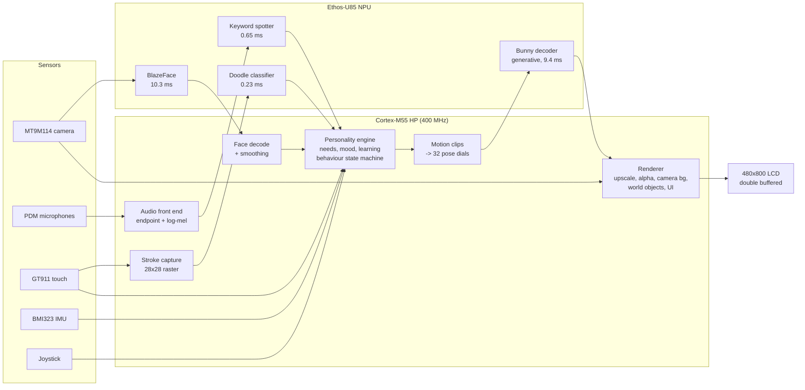

# Alf: an on-device generative AI companion on the Alif Ensemble E8

Alf is a small purple bunny who lives on the Alif E8 DevKit's screen. He is not
a set of pre-drawn sprites: a neural network on the **Ethos-U85 NPU draws every
frame** of him from 32 "pose dials" (ears, eyes, mouth, arms, tilt...). On top of
that sit three more models on the same NPU and a personality engine on the
Cortex-M55, so he can:

- **see you**: in the camera world a face detector finds you, Alf looks at you,
  copies your head tilt and jumps onto your shoulder;
- **hear you**: push-to-talk keyword spotting (up, down, left, right, go, stop,
  yes, no, happy), any voice, no training needed;
- **understand your drawings**: draw a fish, flower, house, cat, sun, star,
  lightning or smiley with your finger, a doodle classifier recognises it and the
  drawing comes to life in his world (he eats the fish, sniffs the flower, runs
  from the cat, naps in the house);
- **feel you**: touch to pet him or send him running, shake the board and he gets
  dizzy;
- **have a mind of his own**: needs (energy, fun, affection, food), moods that
  show on his face, actions chosen at random in proportion to his needs, and he
  learns which spontaneous actions you like when you pet him right after.

Everything runs on the board. No cloud, no host PC, no camera frames stored.

> Arm + Meta ExecuTorch Edge AI Hackathon, SFSU, October 17-18 2026.
> Team: Abdul Mohammed and Awab Ibrahim.
> Judged version: tag **`v1.0-demo`** (the tag points at the exact commit used in the demo).

---

## Contents

1. [What runs where](#1-what-runs-where)
2. [Architecture](#2-architecture)
3. [Performance and memory](#3-performance-and-memory)
4. [The models](#4-the-models)
5. [Build, flash and run](#5-build-flash-and-run)
6. [How to use it (demo controls)](#6-how-to-use-it-demo-controls)
7. [Regenerating the models](#7-regenerating-the-models)
8. [Repository layout](#8-repository-layout)
9. [Design decisions](#9-design-decisions)
10. [Credits and licences](#10-credits-and-licences)

---

## 1. What runs where

| Workload | Runs on | Notes |
|---|---|---|
| **Bunny drawing** (generative decoder, 32 dials -> 96x96 RGB) | **Ethos-U85** | every frame, 9.4 ms |
| **Face detection** (BlazeFace, 128x128 -> 896 anchors) | **Ethos-U85** | every 2nd camera frame, 10.3 ms |
| **Keyword spotting** (DS-CNN, 49x40 log-mel -> 11 classes) | **Ethos-U85** | once per push-to-talk, 0.65 ms |
| **Doodle recognition** (CNN, 28x28 -> 8 classes) | **Ethos-U85** | once per finished drawing, 0.23 ms |
| Personality engine, behaviour state machine, motion clips (pose dials) | Cortex-M55 HP | every frame |
| Rendering: 96->448 px bilinear upscale, alpha matte, bold outline, camera background (auto-gain, white balance, saturation), drawings, effects, UI | Cortex-M55 HP | every frame, double-buffered |
| Audio front end: word endpointing, 256-pt FFT, 40-band log-mel | Cortex-M55 HP | ~28 ms once per command |
| Face decoding (anchor boxes, keypoints, head roll, smoothing) | Cortex-M55 HP | after each detection |
| Camera capture (MT9M114 over MIPI CSI-2 / CPI) | CPI + DMA | asynchronous snapshot, overlaps the NN |
| Display (480x800 MIPI DSI) | CDC200 display controller | double buffer, swap on vsync |
| Microphones (PDM, 8 kHz), IMU (BMI323 over I3C), touch (GT911 over I2C), joystick, RGB LED | peripherals, polled / interrupt | |

The int8 / int16 models are compiled with Vela for the U85 (`ethos-u85-256`,
system config `Ethos_U85_SRAM_Only`); 100% of their operators run on the NPU.
Only the float<->int conversion at the model edges runs on the CPU.

## 2. Architecture



**One frame of the main loop** (`board/DevKit-E8/bunny_demo.c`, `bunny_demo_loop`):

1. Read inputs: touch, joystick, IMU (every 3rd frame), mic loudness, push-to-talk recording.
2. Behaviour: the personality engine updates needs and mood, reacts to input
   (voice command, pet, shake, drawing) or picks a spontaneous action.
3. Pose: the current motion clip (CPU, `bunny_clips.c`) gives 32 dial values;
   mood, gaze at your face and head-tilt mimicry are blended in; the dials are
   sanitised to the range the model was trained on.
4. **NPU**: the bunny decoder turns the dials into a 96x96 image.
5. CPU post-processing: bold outline, alpha matte (so he blends over the camera
   picture without a white halo).
6. Render the whole frame into the hidden buffer: background (white world or the
   colour-corrected camera picture), drawings / world objects, the bunny scaled
   to 448x448, effects (zzz, hearts), speech bubble, UI. In the camera world the
   next camera snapshot and (every 2nd frame) **BlazeFace on the NPU** run here.
7. Swap buffers on vsync, feed the watchdog.

The voice and doodle models run outside this per-frame path, only when a
command was spoken or a drawing was finished.

**Combining the senses** (more than the sum of the inputs):

- "up" means *hop* in the white world, but *jump onto your shoulder* when the
  camera sees a face; "down" while riding means *hop off your shoulder*.
- In the camera world he looks at your face, copies your head roll (from the
  BlazeFace eye keypoints) while riding, and gets wide-eyed if you lean in close.
- Petting right after a spontaneous action teaches him to do it more; shaking the
  board right after teaches him to do it less.
- Faces in view and drawings raise his fun / affection needs, which changes what
  he chooses to do next.

## 3. Performance and memory

Measured on the Alif E8 DevKit, Cortex-M55 HP at 400 MHz, Ethos-U85-256,
cycle counter (DWT). Model timings are averages printed at boot (`bench:`,
`doodle:`, `face:`, `kws:` lines on the UART).

### Latency

| What | Time |
|---|---|
| Bunny decoder on the U85 (100-run average) | **9.4 ms** (min 9.45, max 9.46 ms) |
| Bunny decoder + CPU output conversion (outline, alpha matte) | ~15 ms |
| BlazeFace on the U85 | **10.3 ms** |
| Keyword spotter on the U85 | **0.65 ms** |
| Doodle classifier on the U85 | **0.23 ms** |
| Voice command end to end after the 1.5 s recording (endpointing + log-mel on the CPU + NPU) | ~29 ms |
| Voice command, from releasing the word to the bunny reacting | < 1.6 s (dominated by the fixed 1.5 s recording window) |
| Frame rate, home world (NN every frame) | **20 fps** |
| Frame rate, camera world (camera + colour correction + face detection) | **12-15 fps** |

The NPU is busy for roughly 25% of a home-world frame; the rest is CPU
rendering (upscaling 96x96 to 448x448 with alpha, full-frame redraw for tear-free
double buffering). The NPU is not the bottleneck.

### Accuracy

| Model | Data | Result |
|---|---|---|
| Keyword spotter | Google Speech Commands v2 test split, background noise mixed in at 15 dB SNR | **91.1%** (11 classes); int8 agrees with float on 99.3% |
| Keyword spotter, on the board through the air | laptop speech -> board mic | 8 of 9 words correct, the 9th rejected as "???" (below the 55% confidence bar) |
| Doodle classifier | Quick, Draw! (8 classes), validation | **96.4%** |
| BlazeFace | quantised (a16w8) vs float, face score difference | 0.0005 |

### Memory

| Memory | Used | Of | |
|---|---|---|---|
| SRAM (bulk, 0x02000000) | **7.86 MB** | 8 MB | 98% |
| DTCM (0x20000000) | 389 KB + 96 KB heap + 32 KB stack | 1 MB | |
| MRAM (code + model programs) | 2.25 MB | 3.4 MB app region | |

SRAM breakdown:

| Buffer | Size | Why |
|---|---|---|
| Two frame buffers (480x800x3) | 2.2 MB | tear-free double buffering |
| NPU scratch, **shared** by bunny, face and keyword models | 1.75 MB | the models never run at the same time |
| Bunny model program (SRAM copy) | 1.63 MB | the NPU reads weights/command stream through its SRAM port |
| Camera frame (640x480 RGB565) | 600 KB | |
| Face model: program copy + method pool + input | 850 KB | |
| Method pool (bunny I/O) | 512 KB | |
| Doodle model: program + pools | 224 KB | |
| Keyword model: program + method pool | 144 KB | |

### Optimisations that made it fit and run

- **Shared NPU scratch**: the bunny, face and keyword models use one 1.75 MB
  scratch pool instead of 1.75 + 1.0 + small; without this the camera world did
  not fit.
- **Models copied to SRAM at boot + Vela `Sram_Only`**: the U85's external AXI
  port cannot reach the upper MRAM on this board (a bus abort, NPU status 0x804),
  so programs are copied to SRAM and the driver is set to use the SRAM port
  (`NPU_QCONFIG=0`, `NPU_REGIONCFG_0=0`).
- **16-bit activations for the bunny (a16w8)**: plain int8 collapsed the bunny's
  colours; a16w8 quantisation plus a clamp head (`hardtanh` instead of sigmoid)
  keeps them, still 100% on the NPU.
- **Asynchronous camera snapshots** overlap with the NN instead of blocking;
  continuous video mode was tried and dropped (it corrupted NN memory).
- **BlazeFace every 2nd camera frame**, bunny NN every other frame in the camera
  world, detections smoothed with glitch rejection.
- **Double buffering with vsync swap** removed all flicker/tearing (and gained 2 fps
  by dropping dirty-rectangle bookkeeping).
- **Model sizing measured on the board**: 64x64 / 96x96 / 128x128 bunny decoders
  were exported and timed; 96x96 is the best quality that fits next to the other
  three models (128x128 needs ~2.2 MB more SRAM).

## 4. The models

| Model | Source | Size (program) | Ops on NPU |
|---|---|---|---|
| **Bunny decoder v2** (`model/bunny_decoder_v2.py`) | **ours**: trained on a procedurally rendered dataset of the bunny (`model/bunny/`), 32 dials -> 96x96 RGB | 1.63 MB | 100% |
| **Doodle classifier** (`model/doodle/`) | **ours**: small CNN trained on 8 Quick, Draw! classes | 83 KB | 100% |
| **Keyword spotter** (`model/kws/`) | **ours**: DS-CNN (23k params) trained on Google Speech Commands v2, resampled to the board's 8 kHz | 82 KB | 100% |
| **BlazeFace front** (`model/blazeface/`) | Google MediaPipe (PyTorch port), **exported by us** for the U85 with an output wrapper and a16w8 calibration | 275 KB | 100% (112 ops) |

**Bunny decoder.** A conditional image decoder: 32 dials -> MLP -> reshape ->
upsampling conv blocks (nearest + 3x3 conv, no transposed conv so everything
maps to the NPU) -> RGB. Its training images come from a layered vector rig of
the bunny (`model/bunny/bunny_rig3.py`, `make_dataset.py`), sampled from motion
clips, blends between clips and random poses. On the board, motion clips
(`bunny_clips.c`, a C port of `clips.py`) animate the dials and the NPU draws the
result, so new poses (mood blends, gaze, head-tilt mimicry, a dance) appear
without a single new sprite.

**Keyword spotter.** Features are identical on the laptop and the board:
1 s at 8 kHz, gain-normalised, 30 ms Hamming frames every 20 ms, 256-point FFT,
40 mel bands (20 Hz - 4 kHz), log, minus each band's mean
(`model/kws/kws_features.py` = `board/DevKit-E8/voice.c`; checked on a real
board recording: max difference 8e-6). Trained with background noise at
0-25 dB SNR, +-150 ms time shifts and spectrogram masking. On the board the word
is located in the 1.5 s push-to-talk recording (the loud burst around the
loudest moment) and a 1 s window is centred on it.

## 5. Build, flash and run

### What you need

- Alif Ensemble E8 DevKit (DK-E8) with the MT9M114 camera and the 480x800 MIPI
  display connected, USB-C cable into **PRG USB**.
- VS Code with the **Keil Studio Pack** and **Python** extensions. When the
  folder is opened, the Arm Tools Environment Manager installs the pinned tools
  from `vcpkg-configuration.json` (CMSIS-Toolbox 2.15, Arm Compiler 6.24, CMake,
  Ninja).
- **SEGGER J-Link** software 8.42 or later (the board has an on-board J-Link) and
  **Alif SETOOLS** 1.110 or later (Alif login) for the one-time board setup. Add
  the SETOOLS folder to the VS Code user settings: `"alif.setools.root": "C:/path/to/setools"`.

### One-time board setup

Switch **SW4** selects what the USB serial port talks to: **SEUART** (the Secure
Enclave, used by SETOOLS) or **UART4** (the application console, 115200 8N1).

1. SW4 to **SEUART**, PRG USB connected. In the SETOOLS folder run
   `updateSystemPackage -d` once (answer yes to making the E8 the default target),
   and start J-Link Commander once (it updates the on-board J-Link and installs
   its drivers).
2. Open this folder in VS Code, accept the tool and pack installation, CMSIS view
   -> Manage Solution -> target-type **DevKit-E8** -> Apply.
3. Run **Terminal > Run Task > Alif: Install M55_HP debug stubs (DevKit-E8, single
   core configuration)**. This writes the boot table that lets the Secure Enclave
   start the M55_HP core and the debugger load the application.
4. SW4 back to **UART4**.

### Build

All four model programs are committed (`ai_layer/`, `board/DevKit-E8/*_pte.c`),
so building needs **no Python**.

In VS Code: CMSIS view -> Manage Solution -> target-type **DevKit-E8** -> Build.

Or on the command line (inside the VS Code terminal, where the toolbox is on the PATH):

```bash
cbuild cmsis-executorch.csolution.yml --active DevKit-E8 --packs
```

Output: `out/cmsis-executorch/DevKit-E8/Debug/cmsis-executorch.hex` (and `.axf`).

### Flash

- **VS Code**: CMSIS view -> Run (or Debug). Loads the image into MRAM over the
  on-board J-Link.
- **J-Link Commander** (`JLink.exe -device AE822FA0E5597LS0_M55_HP -if swd -speed 4000`):

  ```text
  Connect
  LoadFile out/cmsis-executorch/DevKit-E8/Debug/cmsis-executorch.hex
  r
  g
  ```

- **Without J-Link** (through the Secure Enclave): SW4 to SE, `tools/flash_se.sh COM4`,
  SW4 back to U4, power-cycle.

### Run

1. SW4 on **UART4**; open a serial terminal on the PRG USB port, **115200 8N1**.
2. Reset or power-cycle the board. The log shows each model loading and its
   speed, then the bunny starts:

   ```text
   ExecuTorch Ethos-U85 example: 1629712 byte model
   bench: BunnyDecoderV2 on Ethos-U85: avg 9448 us, min 9447 us, max 9455 us ...
   doodle: classify 231 us on Ethos-U85
   face: detect 10304 us on Ethos-U85
   kws: classify 654 us on Ethos-U85
   ...
   bunny: running
   bunny: [home] 20 fps, NN 15383 us, state idle, clip idle, ...
   ```

3. Alf waves and says "HEY! MY NAME IS ALF!".

Troubleshooting: if the first model reports `Inference already running` right
after a debugger reset, reset once more (a J-Link reset does not reset the NPU).
A black camera picture with the board lying face-down is just the covered lens.

## 6. How to use it (demo controls)

| Input | What happens |
|---|---|
| Touch the bunny | pet him (hearts, affection; teaches him he did something you like) |
| Tap elsewhere | he runs there |
| Draw with your finger, then wait | the drawing is recognised and comes to life: **fish** (he eats it, fills the food meter), **flower** (sniffs it), **cat** (startled, runs away), **house** (his home, where he naps), **sun**, **star**, **lightning**, **smiley** |
| Eraser button (bottom left) | clear the drawings |
| Camera button (bottom right) | camera world: he looks at you, jumps onto your shoulder, copies your head tilt; house button goes back |
| **Joystick centre** | push to talk: "LISTENING...", then say one word |
| "up" / "down" | hop / lie down (camera world with a face: onto / off your shoulder) |
| "left" / "right" / "go" | walk left / walk right / run to the other side |
| "stop" / "yes" / "no" / "happy" | freeze / clap / pout / **dance** |
| Joystick directions | wave, yawn, hop, clap |
| Shake the board | dizzy (and he learns not to do what he just did) |
| Leave him alone | he wanders, gets bored ("BORED!", "PET ME?"), gets tired and goes to sleep (zzz), wakes up rested |

## 7. Regenerating the models

Only needed to change a model. Create the Python environment once
(`python setup_venv.py`, several GB of PyTorch / ExecuTorch), then from the repo root:

```bash
# Bunny decoder -> ai_layer/ (16-bit activations, 96x96)
AI_LAYER_A16W8=1 BUNNY_SIZE=96 .venv/Scripts/python.exe create_ai_layer.py cmsis-executorch.cbuild-mlops.yml

# Doodle classifier -> board/DevKit-E8/doodle_pte.c
.venv/Scripts/python.exe model/doodle/get_data.py
.venv/Scripts/python.exe model/doodle/train_doodle.py
.venv/Scripts/python.exe model/doodle/export_doodle.py

# Face detector -> board/DevKit-E8/face_pte.c + face_anchors.h
.venv/Scripts/python.exe model/blazeface/export_blazeface.py

# Keyword spotter -> board/DevKit-E8/kws_pte.c
# (needs Speech Commands v2: http://download.tensorflow.org/data/speech_commands_v0.02.tar.gz, 2.3 GB)
.venv/Scripts/python.exe model/kws/train_kws.py --data <path>/speech_commands_v0.02
.venv/Scripts/python.exe model/kws/export_kws.py
```

Then rebuild. Training times on a laptop CPU: keyword spotter ~31 min
(14 epochs), doodle ~8 min. The bunny decoder was trained on a cloud GPU with
`model/bunny/kit_v2/train_bunny.py` on a dataset from `model/bunny/make_dataset.py`.

## 8. Repository layout

```text
board/DevKit-E8/
  bunny_demo.c        main app: loop, personality, behaviour, rendering, camera world, voice, doodles
  bunny_clips.c/.h    motion clips -> 32 pose dials (incl. the dance)
  voice.c/.h          push-to-talk: word endpointing, log-mel features, keyword model call
  camera.c, display.c, mic.c, imu.c   drivers (MT9M114/CPI, CDC200 + DSI double buffer, PDM, BMI323)
  doodle_pte.c, face_pte.c, kws_pte.c, face_anchors.h   generated model programs
  Board-U85.clayer.yml  board layer: components, defines (pool sizes, NPU port setup)
src/app_main.cpp      ExecuTorch runtime: loads the four programs (SRAM copies, shared scratch), benchmarks them
ai_layer/             generated AI layer with the bunny decoder program
model/                PyTorch models, datasets and training / export scripts (bunny, doodle, blazeface, kws)
create_ai_layer.py    PyTorch -> ExecuTorch (PT2E quantisation, Ethos-U partitioner, Vela) -> AI layer
tools/                flash_se.sh (flash via the Secure Enclave), u55_test (the second NPU test)
```

## 9. Design decisions

- **Generative drawing instead of sprites.** Any combination of 32 dials is a new
  image, so moods, gaze, mimicry and new moves (the dance was added in an hour,
  on the CPU only) need no new art. The cost is 9.4 ms of NPU per frame, which
  the U85 has to spare.
- **One NPU, four models, shared scratch.** All four models fit on the U85 with
  the NPU busy ~25% of a frame. We also ran a model on the **Ethos-U55** (same
  network, identical outputs, 385 us vs 249 us on the U85; `tools/u55_test/`).
  Using the U55 *as well* would need a second firmware on the M55_HE core,
  inter-core messaging and ~1.3 MB more SRAM, for a gain of a few camera-world
  fps, because the bottleneck is CPU rendering, not the NPU. We kept one core,
  one NPU and the memory headroom for a stable demo.
- **CPU where the CPU is the right tool.** The audio front end (FFT, mel), face
  decoding, motion clips and the personality engine are small, branchy or
  sequential work that the M55 does in a few ms; the NPU gets the dense
  convolutions.
- **Speaker-independent voice.** A first version used few-shot templates (MFCC +
  DTW) taught on the device; it only knew the teacher's voice and broke in a
  noisy room. It was replaced by a model trained on thousands of speakers with
  noise augmentation, which works for anyone, needs no setup and runs in 0.65 ms.
- **Robustness.** A 3 s watchdog fed every frame, sensor back-off when the touch or
  IMU bus misbehaves, dials sanitised (finite, in range, weights summing to 1)
  before every NN call (a NaN once squashed the bunny), face glitch rejection,
  confidence threshold on voice commands.
- **Privacy.** Camera frames and audio live only in RAM for one frame / one
  command; nothing is stored or sent anywhere.

## 10. Credits and licences

- Base project: [Arm-Examples/CMSIS-Executorch](https://github.com/Arm-Examples/CMSIS-Executorch)
  (Apache 2.0, see `LICENSE`): the CMSIS solution, `create_ai_layer.py` flow and
  ExecuTorch runtime integration. Everything under "Alf" (bunny app, models,
  training, drivers for camera / display / mic / IMU in `board/DevKit-E8/`) was
  written during the hackathon.
- [ExecuTorch](https://github.com/pytorch/executorch) (BSD), Arm Ethos-U driver
  and Vela (Apache 2.0), Alif Ensemble CMSIS pack (Alif licence; driver
  configuration follows Alif's camera / PDM demos).
- **BlazeFace**: Google MediaPipe (Apache 2.0); PyTorch port by Matthijs
  Hollemans, [hollance/BlazeFace-PyTorch](https://github.com/hollance/BlazeFace-PyTorch) (Apache 2.0, same terms as MediaPipe).
- **Google Speech Commands v2**: Pete Warden, 2018 (CC BY 4.0), used to train the
  keyword spotter.
- **Quick, Draw! dataset**: Google (CC BY 4.0), used to train the doodle classifier.
- DS-CNN keyword-spotting architecture after Zhang et al., "Hello Edge: Keyword
  Spotting on Microcontrollers" (Arm, 2017).
- The bunny character design and its vector rig were generated with AI from the
  team's prompts; the training dataset is rendered from that rig by our
  `model/bunny/make_dataset.py`.
- Development was assisted by an AI coding assistant (Claude); the ideas, design
  choices and testing on the hardware are the team's.
